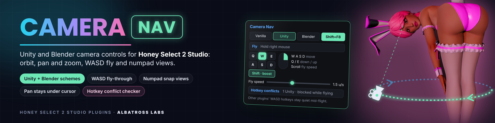

<p align="center">
  
</p>

<p align="center">
  <a href="https://github.com/AlbatrossLabs/HS2CameraNav/releases/latest"></a>
  
  
  <a href="LICENSE"></a>
</p>

# Camera Nav

**Camera Nav replaces Honey Select 2 Studio's camera controls with the ones your hands already know.** Pick Unity-editor or Blender-style navigation and get orbit, pan and zoom on the mouse, WASD fly-through, and numpad snap views.

Switch any time with **Shift+F8** (Vanilla › Unity › Blender) or in F1. Vanilla leaves Studio exactly as it was, so there's nothing to lose by trying it.

## Why

Studio's default camera fights you when you're framing a shot: zoom crawls at long range, panning drifts away from what you're looking at, and there's no way to fly through a big map. Camera Nav keeps Studio's camera data and safety checks and only changes how you steer it:

- **The scene stays under your cursor** when you pan, on any mouse and DPI.
- **Zoom scales with distance**, so it's precise up close and still fast across a whole map.
- **Fly mode** lets you sweep through a scene with WASD like a game editor.
- **Snap views** go straight to front, side or top in Blender mode.
- **Nothing else breaks.** Scene camera slots, saving, MoarCamz and screenshot plugins all see a normal Studio camera.

## Install

1. Install [BepInEx 5](https://github.com/BepInEx/BepInEx) (5.4.23 or newer) and the [IllusionModdingAPI (HS2API)](https://github.com/IllusionMods/IllusionModdingAPI). Both come with BetterRepack and most HS2 modpacks.
2. Download `HS2CameraNav.dll` from [Releases](https://github.com/AlbatrossLabs/HS2CameraNav/releases/latest).
3. Put it in `BepInEx\plugins\` (loose or in its own folder).
4. Start **StudioNEOV2**. Camera Nav starts in Unity mode.

[ConfigurationManager](https://github.com/BepInEx/BepInEx.ConfigurationManager) is recommended (also in most modpacks) for changing settings in-game with **F1**.

## Controls

### Unity scheme

| Action | Input |
|---|---|
| Orbit around the pivot | Alt + Left-drag |
| Pan | Middle-drag, or Alt + Ctrl + Left-drag |
| Zoom | Mouse wheel, or Alt + Right-drag |
| Look around in place | Right-drag |
| Fly | Hold Right mouse + W/A/S/D, Q down, E up, Shift = faster |
| Change fly speed | Scroll while holding Right mouse |

### Blender scheme

| Action | Input |
|---|---|
| Orbit | Middle-drag |
| Pan | Shift + Middle-drag, Ctrl + wheel (sideways), Shift + wheel (up/down) |
| Zoom | Mouse wheel, or Ctrl + Middle-drag |
| Front / Back | Numpad 1 / Ctrl + Numpad 1 |
| Right / Left | Numpad 3 / Ctrl + Numpad 3 |
| Top / Bottom | Numpad 7 / Ctrl + Numpad 7 |
| Opposite side | Numpad 9 |
| Orbit in steps | Numpad 4 / 6 (left / right), 8 / 2 (up / down) |
| Center on selection | Numpad . (moves the pivot to the selected object) |
| No middle button? | Turn on *Emulate 3 button mouse*: Alt + Left-drag acts as Middle-drag |

### Both schemes

- **Plain left-drag still orbits**, like vanilla (*Keep left-drag orbit*, on by default). Left-clicking the viewport doesn't select anything in Studio, so this costs nothing. Turn it off for strict Unity/Blender behavior.
- Studio's keyboard camera keys (arrows, Page Up/Down, Home/End, A to reset, ; for FOV) still work. In Blender mode the numpad keys above replace Studio's numpad rotation.
- Studio's guards still apply: dragging a gizmo or starting a drag over a panel never moves the camera, and camera objects and loading screens disable it like vanilla.
- While flying, Studio's W/E/R/Q gizmo shortcuts and A (reset camera) are paused, so WASD/QE only move the camera.

## Hotkey conflicts

Fly mode and numpad views use keys other plugins like to bind. Camera Nav checks every plugin's hotkey settings when Studio loads, and again whenever a setting changes. It lists any clashes in **F1 › Camera Nav › Hotkey conflicts**, tagged with the scheme they affect, and shows a short on-screen count.

| Tag | Clashes with | What happens |
|---|---|---|
| **Unity (fly)** | W/A/S/D/Q/E, plain or with Shift | Blocked while you fly, works normally otherwise. No rebinding needed. |
| **Blender (numpad)** | Numpad 1–4, 6–9 and Numpad . | Listed. Rebind the other plugin or turn off *Numpad views*. |
| **All schemes** | Camera Nav's *Cycle scheme* key | Listed. Rebind one of them. |

Rebinding a key in F1 updates the list right away.

## Settings (F1 › Camera Nav)

| Group | Settings |
|---|---|
| General | Navigation scheme, cycle-scheme hotkey, keep left-drag orbit |
| Speeds | Orbit, pan, wheel zoom step, drag zoom, closest zoom distance |
| Directions | Invert orbit horizontal/vertical, wheel zoom, drag zoom |
| Unity | Fly speed, Shift boost, look speed |
| Blender | Emulate 3 button mouse, numpad views, numpad step angle |
| Hotkey conflicts | Block while flying, show conflict message, conflict list |

If a drag direction feels backwards compared to the app you're used to, flip it under *Directions*.

## Compatibility

- **Game:** Honey Select 2 Studio (StudioNEOV2). The main game and VR aren't affected.
- **Works alongside:** MoarCamz, scene camera slots, Screencap and other screenshot or video plugins.
- **HS2US camera speed settings** only apply in Vanilla mode, since they tune Studio's own controls.
- **Orthographic view** (Blender's Numpad 5) isn't included. Studio's camera is perspective-only, and Marco's OrthographicCamera plugin covers that.
- **Front view assumes characters face +Z**, Studio's default. On a rotated character, Numpad 1 shows the world front.
- **Conflict detection only sees BepInEx hotkey settings.** A plugin with hardcoded keys isn't listed and can still fire while flying.

## Building from source

Requires the .NET SDK. Game references come from the IllusionMods NuGet feed (see `nuget.config`), so you don't need the game installed to compile.

```
dotnet build -c Release
```

The DLL lands in `bin\Release\`. To copy it into your game after every build, pass your install folder:

```
dotnet build -c Release -p:HS2Dir="C:\Games\HoneySelect2"
```

### How it works

Studio's `CameraControl.LateUpdate` runs `InputMouseWheelZoomProc`, `InputMouseProc` and `InputKeyProc`, each only when Studio allows camera control. Camera Nav prefixes those three with Harmony and edits the same pivot, rotation and distance data vanilla uses. That's why every other camera-aware plugin keeps working.

Mouse movement comes from the raw `Mouse X` / `Mouse Y` axes, because Studio warps the hidden cursor back every frame during a drag. A pixels-per-axis ratio is measured while the mouse moves freely, which keeps the scene pinned under the cursor while panning.

Conflict blocking prefixes BepInEx's `KeyboardShortcut.IsDown` and `IsPressed`, so while flying a shortcut on W/A/S/D/Q/E (alone or with Shift) reads as not pressed.

| File | Purpose |
|---|---|
| `src/CameraNavPlugin.cs` | Settings and the scheme hotkey |
| `src/Patches.cs` | Harmony prefixes on Studio's camera input and BepInEx hotkeys |
| `src/Navigator.cs` | Orbit, pan, zoom, look, fly and numpad math |
| `src/HotkeyConflicts.cs` | Conflict scan, F1 list and on-screen message |
| `src/ConfigurationManagerAttributes.cs` | F1 custom drawer hook |

## Changelog

- **1.0.0:** first stable release. Same features as 0.1.2: Unity and Blender schemes, fly mode, numpad views and the hotkey conflict checker.
- **0.1.2:** hotkey conflict checker. Clashes with other plugins are listed in F1 by scheme, and hotkeys on fly keys are blocked while flying.
- **0.1.1:** fixed drags twitching back toward where they started.
- **0.1.0:** first release. Unity and Blender schemes, fly mode, numpad views.

## License

[MIT](LICENSE)
